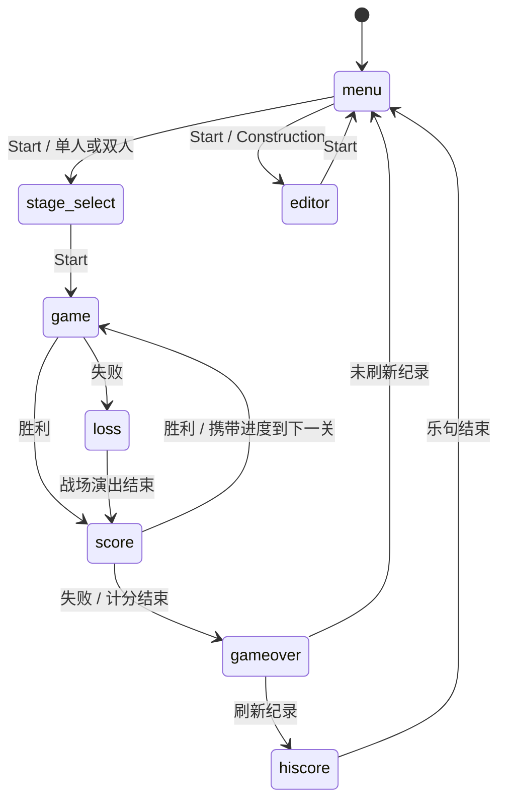

# 开发边界

运行和验收入口见 [README](../../README.md)。本页记录跨模块约束，具体参数由源码与测试维护。

## 模块与所有权

| 模块 | 职责 |
|---|---|
| [bootstrap](../src/app/bootstrap.ts) | 挂载 DOM、Phaser、输入和音频，转发焦点与尺寸事件，统一释放资源 |
| [controller](../src/app/controller.ts) / [AppState](../src/app/state.ts) | 页面流转与固定步进；通过端口接收输入、渲染、音频、随机种子和会话记录，隔离浏览器 API |
| [core](../src/core/) | 确定性游戏规则；相同种子和输入得到相同结果 |
| [ArenaScene](../src/game/arena.ts) | 原生像素绘制、纹理池与动画；借用引擎视图，不修改游戏世界 |
| [GameAudio](../src/platform/audio.ts) → [Transport](../src/platform/audio-transport.ts) → [Runtime](../src/platform/audio-runtime.ts) | 声音语义、命令合并、浏览器音频资源 |
| [Worklet](../src/platform/apu-worklet.ts) → [Driver](../src/platform/apu-driver.ts) → [Synth](../src/platform/apu-synth.ts) | 独立采样时钟、音轨执行与 PCM 合成 |

## 状态与时钟

页面由 `AppState` 描述，战斗阶段由引擎的 `GamePhase` 描述。选关只更新选项，Start 才采样种子并创建 intro 引擎；自定义地图与下一关继承走同一启动路径，第 70 关之后回到第 1 关。

Construction 持有唯一草稿，开战时复制地图。失败演出使用独立世界，计分及 HUD 保留权威结果；计分画面与音效共用 [scoreTimeline](../src/game/score-timeline.ts)。

动画帧提供时间差，控制器按固定步长限额推进。规则步进后更新动画并同步声音，绘制前通过 `commitFrame()` 提交命令；Start 和演出切换也遵循这个顺序。暂停、失焦和隐藏清空累积时间及按键状态，恢复需要显式 Start，不补跑暂停期间的游戏时间。

音符由 Worklet 的采样时钟独立推进，主线程只提交声音变化；主线程短暂阻塞时音乐仍应继续。

## 音频与释放

- [音频协议](../src/platform/audio-protocol.ts) 用 generation 隔离场景、sequence 排除重复消息，命令按槽位合并。有效短音在正常音频 tick 触发，场景切换或暂停边界会清除旧攻击。
- 手动暂停保存持久音轨并播放暂停乐句，失焦立即静音。解除失焦静音必须收到当前节点、当前控制的匹配确认；旧回执或缺失确认不能开放输出。
- 音频失败时先关闭旧图，等待新手势重建，避免原生图重叠或自主重试。恢复只取最新持久声音并按有效播放时间定位，已结束音乐和旧短音不补播。缺少音频 API 时允许静音游戏。
- 初始化尝试与场景世代分别隔离过期回调。`dispose()` 幂等且是终态，统一释放监听、测试桥、Phaser 和音频；晚到回调不能复活实例。HMR 与普通 pagehide 共用释放入口，进入往返缓存时只暂停。

## 维护入口

规则与时序参数见 [core](../src/core/)，音频生命周期及合成回归见 [platform 测试](../tests/platform/)。浏览器用例见 [browser 测试](../tests/browser/)，其中包含 PCM 内容、完整性、暂停静音、恢复和持续播放检查。

[测试适配器](../src/app/test-adapter.ts) 仅在 test 构建提供，跨接口返回独立快照。真实键盘与 PCM 验收不能由测试单步替代；音频探针只观察原生时钟，不驱动播放。重构应保留独立像素回归基线，原作依据及证据缺口见 [参考来源](references.md)。
