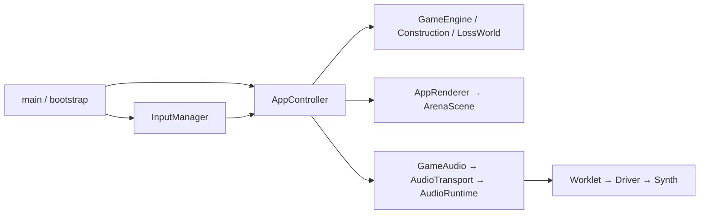

# Web 架构与开发边界

浏览器入口是 `src/main.ts`，负责挂载与开发环境热更新释放。游戏规则、应用流程、绘制、音频分别拥有自己的状态；控制器通过端口连接这些模块。

## 模块与所有权

| 模块 | 负责的状态与操作 |
|---|---|
| [`app/bootstrap.ts`](../src/app/bootstrap.ts) | DOM、Phaser、键盘及焦点监听、尺寸适配、音频资源；统一 `dispose()` |
| [`app/controller.ts`](../src/app/controller.ts) | 页面流转、固定步进、选关预准备、Construction 草稿、会话分数；通过 `AppPorts` 注入输入、音频、渲染、随机种子和记录存储 |
| [`app/state.ts`](../src/app/state.ts) | 可判别的 `AppState`；战斗和结算状态必须携带引擎，失败演出必须携带独立世界，定时页面携带持续时间与已过 tick |
| [`core/`](../src/core/) | 确定性游戏规则、碰撞、敌人、关卡推进；相同种子与输入得到相同结果 |
| [`game/arena.ts`](../src/game/arena.ts) | 满足 `AppRenderer` 端口，由 bootstrap 直接注入；原生像素、纹理池和动画历史 |
| [`platform/audio.ts`](../src/platform/audio.ts) | 游戏事件与音轨语义；传输和浏览器资源见 [音频文档](audio.md) |
| [`app/test-adapter.ts`](../src/app/test-adapter.ts) | 测试快照、控制状态和单步接口，仅在 test 模式构造 |

音符由 Worklet 的采样时钟独立推进；主线程只提交声音状态和事件。主线程短暂卡顿时音乐继续，游戏仍按原固定步进规则运行。Start 在状态同步后、首帧绘制前提交开场命令。

Phaser 使用浏览器原生动画帧并关闭 delta 平滑，把实际帧间时间交给控制器的固定步长累加器。更新不再强制使用 `setTimeout`；`60.0988Hz` 游戏 tick、100ms 帧间隔上限和每帧最多六次步进保持不变。

控制器不读取 `window`、`document`、`crypto` 或 WebAudio。bootstrap 把可见性/焦点转换为 `frame(delta, active)` 和 `inactive()`，把种子生成函数和会话最高分存储注入控制器。

渲染端接收借用的只读顶层游戏视图和只读草稿数组，嵌套实体仍由引擎持有；约定渲染器不修改它们。每帧不复制整个世界。独立失败世界在进入演出时创建，测试快照在跨测试接口时 `structuredClone`。

`dispose()` 移除 DOM 监听和测试桥，停止控制器、释放输入状态、销毁 Phaser 并关闭音频图。重复调用返回同一释放 Promise。HMR 和普通 pagehide 使用同一入口；进入浏览器往返缓存时先暂停，恢复后仍需 Start。

## 检查与变更

测试宿主使用 Node 24 类型和 ES2023 库类型；应用保持自己的目标配置。开发命令见 [README](../../README.md#开发)，完整检查流程见 [桌面验收](validation.md)。

`validate:desktop` 串联现有 npm 检查命令，CI 使用同一入口。Playwright 管理浏览器、测试服务和报告；生产冒烟同时检查发布资源与许可文件。

单元测试按规则、应用端口、浏览器适配、音频资源/传输、实际 Worklet 与合成器分层。原有键盘集成测试仍验证 bootstrap 与控制器的真实接线。Construction 的模拟像素在测试 fixture 内缓存诊断扫描，字节一致性使用 `Buffer.equals`；仅键盘准备测试组使用 15 秒预算，不启用重试。

[应用状态与时序](state-machine.md) · [音频协议与恢复](audio.md) · [桌面验收](validation.md) · [参考资料与证据缺口](references.md)
