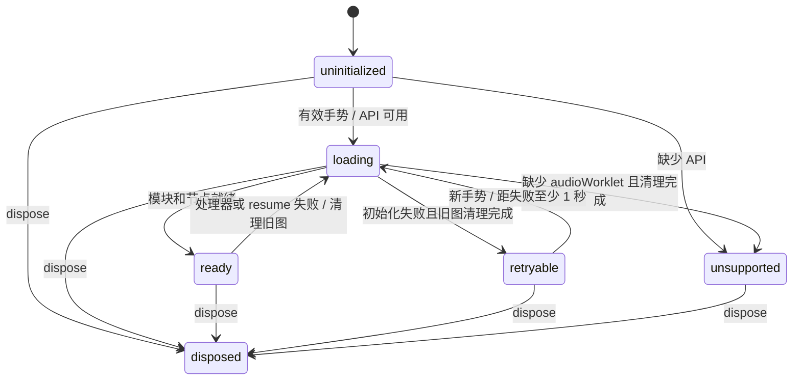

# 音频职责、协议与恢复

| 层 | 责任 |
|---|---|
| [`GameAudio`](../src/platform/audio.ts) | GameEvent/场景/计分到 cue 的映射；当前音乐、音乐 tick 偏移、玩家/敌人引擎声、计分去重 |
| [`AudioTransport`](../src/platform/audio-transport.ts) | tick 帧、12 帧额度、待发送队列、generation、sequence、ACK/progress、过期短音和暂停屏障 |
| [`AudioRuntime`](../src/platform/audio-runtime.ts) | AudioContext、GainNode、WorkletNode、手势解锁、加载与 resume、重试、断开和关闭 |
| [`apu-worklet`](../src/platform/apu-worklet.ts) / Driver / Synth | 按采样时间消费消息、执行音轨字节码、生成 PCM；不读取页面游戏状态 |

## 原生图生命周期

`loading` 也覆盖失败后尚未完成的 `close()`，避免两张原生图重叠。`ready` 表示节点已建立；Context 暂停及其 resume 屏障仍单独控制是否允许提交与出声。缺少音频 API 时静音，键盘游戏继续工作。

一次初始化只有一个模块加载。失败会静音、断开 Worklet 和 Gain、关闭消息端口并关闭 Context；清理结束后等待下一次有效手势，并检查失败后 1 秒的下限。不设置自主重试计时器。新尝试创建新的 Context，因为 Worklet 会在同一实例中缓存模块加载结果（包括失败）；仅清空 Promise 不足以保证重新获取模块。

初始化编号与音频场景 generation 分开：关闭或失败即使编号失效，晚到的加载/resume/processorerror 回调不会重建旧图或关闭新图。恢复时读取最新场景、最新音乐 tick 偏移及引擎声音，旧场景、射击和计数短音不会补播。

`dispose()` 是终态且幂等，同时覆盖加载过程中销毁。bootstrap 等待原生关闭 Promise；排队的加载和消息回调不能让实例复活。

## 线程消息与屏障

双方共享 [`audio-protocol.ts`](../src/platform/audio-protocol.ts)，消息格式保持如下：

| 消息 | 方向 | 含义 |
|---|---|---|
| `reset` | 主线程 → Worklet | generation、当前 tick、持续 cue 与音乐偏移；本地溢出可附带仍新鲜的未发送短音 |
| `pause` | 主线程 → Worklet | 暂停原因、当前 tick，以及需同步后丢弃的队列和 cue |
| `frames` | 主线程 → Worklet | sequence、原生起播时间和按 tick 排序的 start/stop 帧；空帧用于证明 reset/unpause 已被 FIFO 接收 |
| `ack` | Worklet → 主线程 | 当前 sequence 接收结果、剩余额度及可用采样游标 |
| `progress` | Worklet → 主线程 | 已消费后的额度与采样游标，不得覆盖尚未确认的新批次预留 |

Gain 在当前 generation 的有效 ACK 到达前关闭。空场景在 ACK 后仍保持静音；手动暂停播放独立暂停乐句，焦点暂停立即静音。Gain 只缓存成功的原生写入，写入异常不会被误认为已经静音或解除静音。

传输最多预留 12 帧，包括未确认批次。过期超过 2 个音频 tick 的短音从 start 中剔除，持续 cue、stop 和实际 tick 顺序保留。拒绝的有效批次或队列溢出建立新 generation；只有本地未发送、仍在新鲜窗口内的短音可以随溢出恢复，暂停和上下文恢复不带入旧攻击。

## 验证

`audio-runtime.test.ts` 验证 native 资源生命周期；`audio-transport.test.ts` 通过端口验证额度与屏障；`audio.test.ts` 保留事件映射和真实 processor/driver/synth 耦合的回归。所有场景准备通过公共调用建立，不修改音频私有状态。

浏览器 `audio-real.spec.ts` 在 Chromium 和 WebKit 中让原生 `addModule` 首次请求一个无效地址，等待旧 Context 关闭，按键触发新 Context，并测量当前场景的实际 PCM。该故障用例使用独立 worker 和原生浏览器进程，隔离设备关闭/重建对后续时延测量的影响，继续沿用项目的 context、trace 和截图配置。采样侧支只观察音频，不推进游戏或音频时间；旧图的样本、事件和传输日志独立归档，新图使用新时间轴，既有错误不会被清空。该用例也在生产构建执行。
