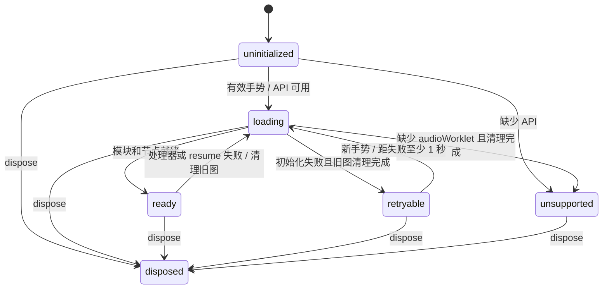

# 音频职责、协议与恢复

| 层 | 责任 |
|---|---|
| [`GameAudio`](../src/platform/audio.ts) | GameEvent/场景/计分到 cue 的映射；当前音乐、有效播放时长、玩家/敌人引擎声、计分去重 |
| [`AudioTransport`](../src/platform/audio-transport.ts) | 按槽位合并命令、generation/sequence 与暂停控制 |
| [`AudioRuntime`](../src/platform/audio-runtime.ts) | AudioContext、GainNode、WorkletNode、失焦静音与恢复确认、手势解锁、加载与 resume、重试、断开和关闭 |
| [`apu-worklet`](../src/platform/apu-worklet.ts) / Driver / Synth | 按采样时间消费消息、执行音轨字节码、生成 PCM；不读取页面游戏状态 |

## 原生图生命周期

`loading` 也覆盖失败后尚未完成的 `close()`，避免两张原生图重叠。`ready` 表示节点已建立；Context 暂停及其 resume 屏障仍单独控制是否允许提交与出声。缺少音频 API 时静音，键盘游戏继续工作。

一次初始化只有一个模块加载。失败会静音、断开 Worklet 和 Gain、关闭消息端口并关闭 Context；清理结束后等待下一次有效手势，并检查失败后 1 秒的下限。不设置自主重试计时器。新尝试创建新的 Context，因为 Worklet 会在同一实例中缓存模块加载结果（包括失败）；仅清空 Promise 不足以保证重新获取模块。

初始化编号与音频场景 generation 分开：关闭或失败即使编号失效，晚到的加载/resume/processorerror 回调不会重建旧图或关闭新图。恢复时读取最新场景、按单调时钟计算、扣除显式暂停的音乐偏移及引擎声音，旧场景、射击和计数短音不会补播。

`dispose()` 是终态且幂等，同时覆盖加载过程中销毁。bootstrap 等待原生关闭 Promise；排队的加载和消息回调不能让实例复活。

## 音频时钟与控制消息

Worklet 按实际采样率、输出块长度和分数采样相位，以 `60.0988Hz` 推进原有 Driver。主线程不再传输空帧，也不参与音符计时。一次播放命令足以播放完整音轨，主线程卡顿时音乐继续，游戏规则仍使用原固定步长。原字节码、四声道抢占、解码到硬件写入的一帧延迟不变。

| 消息 | 主线程 → Worklet |
|---|---|
| `reset` | 新 generation、当前音乐及偏移、引擎声音和暂停态，原子替换旧场景 |
| `commands` | 当前 generation/sequence，以及槽位 id/start 操作 |
| `pause` | 当前 generation/sequence、暂停原因、暂停前尚未提交的持久声音操作 |

`commitFrame()` 仅提交声音变化，Start 在同步开场状态后立即调用它。发送端和接收端都按 28 个槽位合并最后一次操作。普通声音命令单向发送，不等待回执；Worklet 丢弃旧世代及重复序号，负责场景静音、暂停和恢复。

失焦暂停先由 Runtime 将 GainNode 设为零，再发送控制消息。目标音量单独保存，静音期间提交音效、调整音量或重置状态都不能提前开放输出。解除失焦静音的 `reset/pause` 才附带 `confirm: true`；Worklet 应用有效控制后返回 `control-applied`，携带 generation/sequence（reset 的 sequence 为零）。Runtime 只接受当前节点与最新待确认控制完全匹配的回执，再恢复目标音量。再次失焦会作废旧确认；旧节点、旧控制、重复和无效回执均不能解除静音。确认缺失时保持静音，不设置确认计时器、心跳或自动重试；原生图失败仍沿用既有清理与手势重建流程。

同一场景内仍有效的短音，即使因调度迟到，也在下一个正常音频 tick 触发。命令只包含 `id/start`，不携带创建时间，也不按固定毫秒期限丢弃；发送端与接收端仍按槽位保留最后一次操作，旧世代、重复序号和暂停边界仍使旧攻击失效。解码后的首次写入保留完整音频帧，不补造游戏 tick，不重播被合并或清除的攻击。迟到是否满足响应要求由下面的 PCM 验收独立判定。

暂停保存持久 Driver 状态及分数相位，丢弃待播和已在播放的短音；恢复前的下一个普通音频 tick 清除旧硬件输出，不补跑暂停期间的时间。手动暂停仍播放独立暂停乐句；失焦输出零。新图或原生 Context 恢复只取最新持久快照：有限音乐按有效时长定位，已结束的乐句不重播，引擎循环从最新状态启动。旧攻击不跨图恢复。控制消息在节点存在时即可排队，不必等待 Context 运行。

## 验证

`audio-runtime.test.ts` 验证 native 资源生命周期、失焦静音及恢复确认的竞态；`audio-transport.test.ts` 通过端口验证命令合并和暂停控制，无需创建原生音频图；`audio.test.ts` 保留事件映射、异步恢复和真实 processor/driver/synth 耦合的回归，并验证迟到的有效短音仍会播放。所有场景准备通过公共调用建立，不修改音频私有状态。

浏览器探针记录每张音频图的首个 `reset`，复制音乐数组以验证恢复时的曲目及偏移。生命周期用例额外启用 `observeDelivery`：正式采集开始后，记录射击槽位 $0F 与 reset/pause 控制的发送时刻、世代、序号和消息副本，每图最多 64 条；超限标记 `overflow`，观测故障标记 `unavailable`。记录证明发送端已提交消息，不代表 Worklet 已执行或已经出声。原生消息原样转发，应用自行接收控制回执。旧图的样本、事件、首个 `reset` 和投递记录独立归档，新图使用新时间轴，既有错误不清空。

采样侧支不推进游戏或音频时间。PCM 快照保留浮点原始字节、子数组边界及 quantum 标签，优先使用原生 Base64 编码，缺少该 API 时分块编码；通过单个 JSON 字符串传回 Node 分析。覆盖等待每 25ms 检查采样标签，墙钟超时为 15 秒。丢包、乱序、重复、非有限值和覆盖不足均须失败。

生命周期用例在 Construction 和关卡选择完成后才创建采样 Worklet，等收到真实采样包再开始记录。游戏音频仍由首次有效按键初始化；开场及恢复用例继续立即安装采样侧支。重复激活不会创建第二个探针，旧音频图晚到的加载结果不能挂接到新图。

Construction 准备固定使用 256×240 视口，在菜单确认一次画布位置，之后读取同一区域的合成截图并解码 PNG。每次截图使用当前 20 秒观察期限的剩余时间；游标、方块及整行钢墙仍须通过原有像素断言。失败附件保留阶段、正在执行和最后完成的操作、阶段耗时及最后有效像素，迟到回调和按键清理不能覆盖首个失败。

射击和开场采集完整 500ms 窗口，暂停采集完整 1 秒窗口，再导出一次。失败附件统一为 `audio-measurement-failure`，包含测量名称、同一次采集的 PCM、参数、已有分析结果、原始错误及定位参数；启用的投递记录随同一份快照保存，诊断溢出、观测或附件故障不能替换原始错误。

### 浏览器验收要求

| 场景 | 判定与观察 |
|---|---|
| 正常开场 | 真实 Enter 前 120ms 静音；首音须在按键后 500ms 之前出现，整个窗口峰值 `<0.5`。实际首音后 15–100ms 要求 `RMS >0.008`、峰值 `<0.5`，并验证三个声部及最终乐句。记录 90ms 性能目标是否超出，超出目标本身不失败。 |
| 热态射击 | 完整匹配 940/756/608Hz 下降特征及闲置幅值余量；起音上界取首个确认特征的 8ms 分析窗口末端。50ms 为观察目标，150ms 为验收上限。引擎首个非零样本不能充当射击起音。 |
| 手动暂停 | 匹配 C5/D5/E5/C6/D6/E6/G5 七个音符及 4/4/4/4/4/4/12 帧时序，再以首个超过 0.002 的样本定位起音。响应目标/上限为 50ms/150ms；起音后 80–220ms 要求 `RMS >0.003`，680–820ms 峰值严格为零。 |
| 失焦与恢复 | 保留失焦静音窗口及恢复验证；Runtime 单测检查旧节点、旧控制和无效回执不能提前解除静音。 |
| 原生图重建 | 首次 `addModule` 请求无效地址；旧 Context 关闭后由新手势创建新图，验证当前曲目、正偏移及实际 PCM。无自主重试。 |
| 主线程阻塞 | 开场 PCM 正常播放后分别阻塞 150ms/300ms，验证原生音频连续播放，使用真实时钟。 |
| 计分与终局 | 验证计分短音及结束静音、GAME OVER 所属页面、HISCORE 完整乐句及返回菜单后的静音。 |

恢复和生命周期用例分别使用独立 worker 与浏览器进程，保留项目的 context、trace 和截图配置。Chromium、WebKit 均执行实际 PCM 检查；恢复、开场、阻塞及生命周期用例也运行于生产构建。场景观察使用真实场景回调，生产构建不提供调试入口。

响应边界按采样帧比较，记录延迟、采样率、测量分辨率及是否超过目标；无首音时延迟为空。按键到 PCM 的上限包含游戏更新等待，超过 150ms 仍失败，500ms 射击窗口内缺少特征也仍失败。以上为项目的软件指标，不包含声卡、扬声器或蓝牙链路；继续播放迟到音效不代表其通过响应验收。

成功与失败附件从同一份 PCM 快照的投递记录匹配命令，补充按键到提交、提交到首音两段时间，不增加测量期间的查询或控制回执。找不到唯一命令、跨越重置/暂停边界或诊断溢出时明确标为缺失、歧义或不可用，不改变原始 PCM 判定。Playwright 同时输出 JSON 报告，按构建和浏览器汇总样本数、50ms 达标率、P50/P95、最大值及未测得次数；准备失败也计入验收，不能仅统计成功样本。

`audio-response.test.ts` 用独立音符及时序验证正常、迟到、缺音、错音、截短、引擎干扰和静音残留，并与原生合成器交叉检查。原版暂停序列来源为固定反汇编版本的 EE2C–EE39，参见 [参考资料](references.md)。

### 指标依据

原版在 NMI 的 D439 调用声音驱动，EA7E–ECAC 先写寄存器再解码后续音符；本项目保留帧级节奏、槽位优先级和一帧解码延迟，固定毫秒过期并非原版规则。来源版本与地址见 [参考资料](references.md)。

[Web Audio 规范](https://www.w3.org/TR/2026/WD-webaudio-1.1-20260922/#enumdef-audiocontextlatencycategory) 将默认 `interactive` 定义为避免断音前提下的最低输出延迟，没有为游戏规定统一的毫秒验收线。[Android 官方说明](https://developer.android.com/ndk/guides/audio/audio-latency) 的低延迟音频标志要求连续输出延迟不超过 45ms，测量的是样本生成到设备输出，与这里的按键到 PCM 区间不同。因此 50ms 目标和 150ms 上限是项目选择，不宣称为原版或行业统一标准。资料核对日期：2026-10-21。
