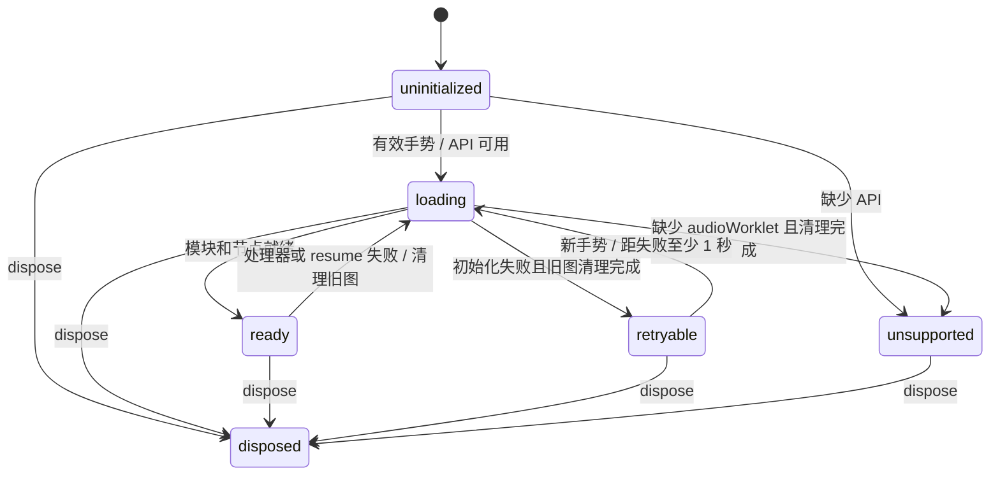

# 音频职责、协议与恢复

| 层 | 责任 |
|---|---|
| [`GameAudio`](../src/platform/audio.ts) | GameEvent/场景/计分到 cue 的映射；当前音乐、有效播放时长、玩家/敌人引擎声、计分去重 |
| [`AudioTransport`](../src/platform/audio-transport.ts) | 按槽位合并命令、generation/sequence、短音过期与暂停控制 |
| [`AudioRuntime`](../src/platform/audio-runtime.ts) | AudioContext、GainNode、WorkletNode、失焦静音与恢复确认、手势解锁、加载与 resume、重试、断开和关闭 |
| [`apu-worklet`](../src/platform/apu-worklet.ts) / Driver / Synth | 按采样时间消费消息、执行音轨字节码、生成 PCM；不读取页面游戏状态 |

## 原生图生命周期

`loading` 也覆盖失败后尚未完成的 `close()`，避免两张原生图重叠。`ready` 表示节点已建立；Context 暂停及其 resume 屏障仍单独控制是否允许提交与出声。缺少音频 API 时静音，键盘游戏继续工作。

一次初始化只有一个模块加载。失败会静音、断开 Worklet 和 Gain、关闭消息端口并关闭 Context；清理结束后等待下一次有效手势，并检查失败后 1 秒的下限。不设置自主重试计时器。新尝试创建新的 Context，因为 Worklet 会在同一实例中缓存模块加载结果（包括失败）；仅清空 Promise 不足以保证重新获取模块。

初始化编号与音频场景 generation 分开：关闭或失败即使编号失效，晚到的加载/resume/processorerror 回调不会重建旧图或关闭新图。恢复时读取最新场景、按单调时钟计算、扣除显式暂停的音乐偏移及引擎声音，旧场景、射击和计数短音不会补播。

`dispose()` 是终态且幂等，同时覆盖加载过程中销毁。bootstrap 等待原生关闭 Promise；排队的加载和消息回调不能让实例复活。

## 音频时钟与控制消息

Worklet 按实际采样率、输出块长度和分数采样相位，以 `60.0988Hz` 推进原有 Driver。主线程不再传输空帧，也不参与音符计时。一次播放命令足以播放完整音轨，主线程卡顿时音乐继续，游戏规则仍使用原固定步长。原字节码、四声道抢占、解码到硬件写入的一帧延迟不变。

| 消息 | 主线程 → Worklet |
|---|---|
| `reset` | 新 generation、当前音乐及偏移、引擎声音和暂停态，原子替换旧场景 |
| `commands` | 当前 generation/sequence、原生发送时间 sentAt，以及带 createdAt 的槽位 start/stop |
| `pause` | 当前 generation/sequence、暂停原因、暂停前尚未提交的持久声音操作 |

`AppAudio.advanceTick()` 已删除；`commitFrame()` 仅提交声音变化，Start 在同步开场状态后立即调用它。发送端和接收端都按 28 个槽位合并最后一次操作，没有逐游戏帧队列、credits、progress、空消息握手或溢出恢复。普通声音命令单向发送，不等待回执；Worklet 丢弃旧世代及重复序号，负责场景静音、暂停和恢复。

失焦暂停先由 Runtime 将 GainNode 设为零，再发送控制消息。目标音量单独保存，静音期间提交音效、调整音量或重置状态都不能提前开放输出。解除失焦静音的 `reset/pause` 才附带 `confirm: true`；Worklet 应用有效控制后返回 `control-applied`，携带 generation/sequence（reset 的 sequence 为零）。Runtime 只接受当前节点与最新待确认控制完全匹配的回执，再恢复目标音量。再次失焦会作废旧确认；旧节点、旧控制、重复和无效回执均不能解除静音。确认缺失时保持静音，不设置确认计时器、心跳或自动重试；原生图失败仍沿用既有清理与手势重建流程。

计分声从原始 createdAt 起有效 100ms，发送及实际执行时都检查，重新排队不刷新期限。其他短音保留原有两个音频 tick 预算：发送前按 createdAt，Worklet 按 sentAt 检查。持久音与 stop 不过期。有效的迟到计分声只触发一次，解码后的首次写入自然保留完整音频帧，不补造游戏 tick。

暂停保存持久 Driver 状态及分数相位，丢弃待播和已在播放的短音；恢复前的下一个普通音频 tick 清除旧硬件输出，不补跑暂停期间的时间。手动暂停仍播放独立暂停乐句；失焦输出零。新图或原生 Context 恢复只取最新持久快照：有限音乐按有效时长定位，已结束的乐句不重播，引擎循环从最新状态启动。时间戳仅在对应原生图内使用，旧攻击不跨图恢复。控制消息在节点存在时即可排队，不必等待 Context 运行。

## 验证

`audio-runtime.test.ts` 验证 native 资源生命周期、失焦静音及恢复确认的竞态；`audio-transport.test.ts` 通过端口验证命令合并、短音过期和暂停控制，无需创建原生音频图；`audio.test.ts` 保留事件映射、异步恢复和真实 processor/driver/synth 耦合的回归。所有场景准备通过公共调用建立，不修改音频私有状态。

浏览器 `audio-real.spec.ts` 在 Chromium 和 WebKit 中让原生 `addModule` 首次请求一个无效地址，等待旧 Context 关闭，按键触发新 Context，并测量当前场景的实际 PCM。该故障用例使用独立 worker 和原生浏览器进程，隔离设备关闭/重建对后续时延测量的影响，继续沿用项目的 context、trace 和截图配置。采样侧支只观察音频，不推进游戏或音频时间；旧图的样本、事件和传输日志独立归档，新图使用新时间轴，既有错误不会被清空。该用例也在生产构建执行。

PCM 快照优先用原生 `Uint8Array.toBase64()` 搬运原始字节，不支持时保留分块编码；两条路径均保留子数组边界、浮点位模式及原始 quantum 标签。快照通过一个 JSON 字符串传回 Node，避免浏览器自动化逐层序列化对象阻塞游戏线程；PCM 字节仍用 Base64 保真，无效采样标签仍须失败。覆盖等待每 25ms 检查实际收到的采样标签，不请求额外动画帧，也不改变原生截止时间。射击检查等原有 500ms 窗口采集完整再导出一次，在 Node 中验证整个窗口并匹配波形，避免窗口内反复导出干扰主线程调度。快照的可选 `timing` 记录页面内筛选、编码和诊断复制耗时，只用于定位观察开销，不参与通过判定。采样缺口、非有限值、过期短音和波形阈值仍按原规则处理。

正常开场使用真实 Enter，先检查按键前 120ms 静音，再完整采集按键后的 500ms PCM。首个超过既有振幅阈值的样本必须在 500ms 之前出现；无首音或在 500ms 及以后才起音均失败，整个窗口还须满足峰值 `<0.5`。音质另取实际首音后 15–100ms 的固定片段，检查 `RMS >0.008`、峰值 `<0.5`；正常开场保留原三个声部的频率、幅值和最终乐句完整性检查。这样等待首音的静音不会被重复算作音量不足。完整采样覆盖仍使用既有 15 秒墙钟超时，丢包、乱序、重复、非有限样本和覆盖不足不能被首音出现掩盖。

每次开场记录首音延迟、是否超过 90ms、采样率和功能上限；没有首音时延迟保持为空。90ms 是历史性能观察目标，超过它本身不阻断验收。500ms 是项目自定的 CI 故障上限，用于发现无声和异常迟到，不是日常听感目标或业界统一标准。这里的延迟使用 AudioContext/PCM 时间坐标，没有覆盖完整硬件输出链路；通过不代表真实设备的按键到听见声音延迟已经达标。确定性音频单测的时间要求及失焦静音等其他窗口不随此调整。

浏览器另有 150ms/300ms 主线程阻塞回归：先执行同一开场功能检查，确认实际 PCM 已正常播放后再阻塞页面，检查原生 PCM 在阻塞期间继续播放，不安装假时钟。场景探针继续包裹实际场景回调；生产构建没有调试入口。Worklet 音频时钟消除对游戏帧和回执的持续依赖，但不能保证浏览器首次投递命令的延迟。

WebKit 的本地定位记录表明，同一个按键事件中 postMessage 后立即阻塞主线程，会推迟 Worklet 首次收到命令。该压力场景及既有 A/B 实验作为历史证据归档；已开始播放的连续性测试不能替代正常开场检查，实验中的 24 组配对、五对改善等采纳条件也不是日常验收门槛。
