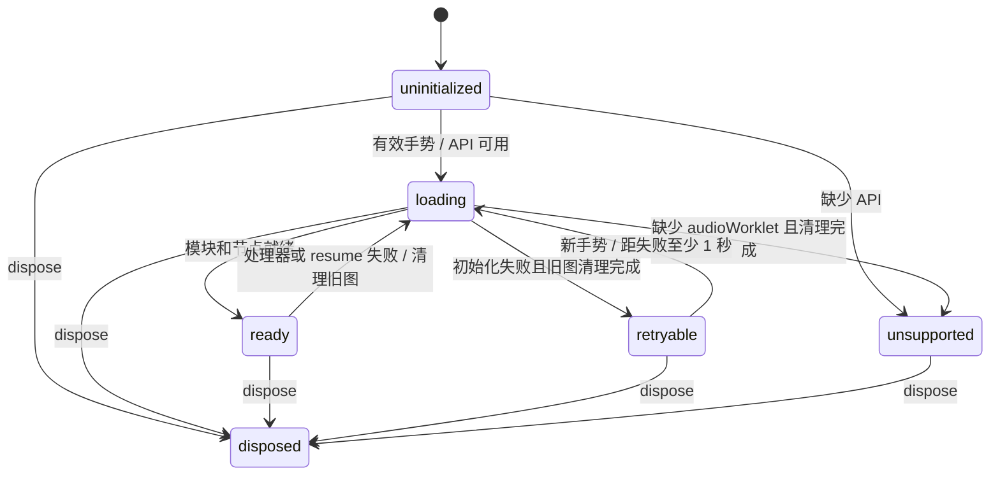

# 音频职责、协议与恢复

| 层 | 责任 |
|---|---|
| [`GameAudio`](../src/platform/audio.ts) | GameEvent/场景/计分到 cue 的映射；当前音乐、有效播放时长、玩家/敌人引擎声、计分去重 |
| [`AudioTransport`](../src/platform/audio-transport.ts) | 按槽位合并命令、generation/sequence 与暂停控制 |
| [`AudioRuntime`](../src/platform/audio-runtime.ts) | AudioContext、GainNode、WorkletNode、失焦静音与恢复确认、手势解锁、加载与 resume、重试、断开和关闭 |
| [`apu-worklet`](../src/platform/apu-worklet.ts) / Driver / Synth | 按采样时间消费消息、执行音轨字节码、生成 PCM；不读取页面游戏状态 |

## 原生图生命周期

`loading` 也覆盖失败后尚未完成的 `close()`，避免两张原生图重叠。`ready` 表示节点已建立；Context 暂停及其 resume 屏障仍单独控制是否允许提交与出声。缺少音频 API 时静音，键盘游戏继续工作。

一次初始化只有一个模块加载。失败会静音、断开 Worklet 和 Gain、关闭消息端口并关闭 Context；清理结束后等待下一次有效手势，并检查失败后 1 秒的下限。不设置自主重试计时器。新尝试创建新的 Context，因为 Worklet 会在同一实例中缓存模块加载结果（包括失败）；仅清空 Promise 不足以保证重新获取模块。

初始化编号与音频场景 generation 分开：关闭或失败即使编号失效，晚到的加载/resume/processorerror 回调不会重建旧图或关闭新图。恢复时读取最新场景、按单调时钟计算、扣除显式暂停的音乐偏移及引擎声音，旧场景、射击和计数短音不会补播。

`dispose()` 是终态且幂等，同时覆盖加载过程中销毁。bootstrap 等待原生关闭 Promise；排队的加载和消息回调不能让实例复活。

## 音频时钟与控制消息

Worklet 按实际采样率、输出块长度和分数采样相位，以 `60.0988Hz` 推进原有 Driver。主线程不再传输空帧，也不参与音符计时。一次播放命令足以播放完整音轨，主线程卡顿时音乐继续，游戏规则仍使用原固定步长。原字节码、四声道抢占、解码到硬件写入的一帧延迟不变。

| 消息 | 主线程 → Worklet |
|---|---|
| `reset` | 新 generation、当前音乐及偏移、引擎声音和暂停态，原子替换旧场景 |
| `commands` | 当前 generation/sequence，以及槽位 id/start 操作 |
| `pause` | 当前 generation/sequence、暂停原因、暂停前尚未提交的持久声音操作 |

`commitFrame()` 仅提交声音变化，Start 在同步开场状态后立即调用它。发送端和接收端都按 28 个槽位合并最后一次操作。普通声音命令单向发送，不等待回执；Worklet 丢弃旧世代及重复序号，负责场景静音、暂停和恢复。

失焦暂停先由 Runtime 将 GainNode 设为零，再发送控制消息。目标音量单独保存，静音期间提交音效、调整音量或重置状态都不能提前开放输出。解除失焦静音的 `reset/pause` 才附带 `confirm: true`；Worklet 应用有效控制后返回 `control-applied`，携带 generation/sequence（reset 的 sequence 为零）。Runtime 只接受当前节点与最新待确认控制完全匹配的回执，再恢复目标音量。再次失焦会作废旧确认；旧节点、旧控制、重复和无效回执均不能解除静音。确认缺失时保持静音，不设置确认计时器、心跳或自动重试；原生图失败仍沿用既有清理与手势重建流程。

同一场景内仍有效的短音，即使因调度迟到，也在下一个正常音频 tick 触发。命令只包含 `id/start`，不携带创建时间，也不按固定毫秒期限丢弃；发送端与接收端仍按槽位保留最后一次操作，旧世代、重复序号和暂停边界仍使旧攻击失效。解码后的首次写入保留完整音频帧，不补造游戏 tick，不重播被合并或清除的攻击。迟到是否满足响应要求由下面的 PCM 验收独立判定。

暂停保存持久 Driver 状态及分数相位，丢弃待播和已在播放的短音；恢复前的下一个普通音频 tick 清除旧硬件输出，不补跑暂停期间的时间。手动暂停仍播放独立暂停乐句；失焦输出零。新图或原生 Context 恢复只取最新持久快照：有限音乐按有效时长定位，已结束的乐句不重播，引擎循环从最新状态启动。旧攻击不跨图恢复。控制消息在节点存在时即可排队，不必等待 Context 运行。

## 验证

单元测试分别覆盖游戏事件映射、传输合并、原生资源生命周期、失焦静音与恢复确认，以及真实 processor/driver/synth 的协作。场景通过公共调用建立，不修改音频私有状态。

浏览器使用旁路 Worklet 采集真实 PCM，不推进游戏或音频时间。探针记录键盘和场景时间以定位采样窗口，并保留每张音频图的首个 `reset` 检查恢复曲目与偏移。换图后分别保存旧图的样本和定位信息，错误不清空，旧图晚到的加载不能接入新图。生命周期测试在 Construction 准备完成后才启用采样，避免准备阶段重复采集。

PCM 按原始浮点字节及 quantum 标签导出，在 Node 分析。采样等待保留 15 秒墙钟超时；缺包、乱序、重复、非有限值和覆盖不足均失败。失败附件 `audio-measurement-failure` 保存实际分析的 PCM、参数、已有分析结果、定位参数及原始错误；附件故障不能替换原始失败。不收集命令投递日志或响应性能统计。

### Chromium 完整音频检查

| 场景 | 正确性判定 |
|---|---|
| 开场 | Enter 前 120ms 静音；按键后采集 1 秒寻找实际起音，峰值 `<0.5`。起音后 15–100ms 要求 `RMS >0.008`，验证三个声部及最终乐句。 |
| 移动与射击 | 对比闲置状态确认玩家引擎声。射击采集 1 秒，匹配 940/756/608Hz 下降特征及原有幅值余量，背景引擎或爆炸不能代替射击。 |
| 手动暂停 | 采集 2 秒，匹配 C5/D5/E5/C6/D6/E6/G5 七个音符及 4/4/4/4/4/4/12 帧节奏；相对实际起音检查 80–220ms 的 `RMS >0.003` 和 680–820ms 的严格静音。 |
| 失焦与恢复 | 失焦输出零，显式 Start 后恢复；单测保证旧节点、旧控制及无效回执不能解除静音。 |
| 原生图重建 | 首次模块加载失败，关闭旧图后由新手势重建；检查当前曲目、正偏移与实际出声，无自主重试。该用例使用独立浏览器隔离设备重建。 |
| 主线程阻塞 | 已出声后分别阻塞主线程 150ms/300ms，验证 Worklet 继续输出正常 PCM。 |
| 计分与终局 | 计分短音结束后静音，GAME OVER 音乐对应所属页面，HISCORE 乐句完整，返回菜单后静音。 |

采集窗口限定内容搜索范围；项目不再设置按键到起音的精细时延门槛或性能达标率。波形、音高、节奏、完整性和静音断言继续生效。独立测试覆盖较晚开始的正确声音，以及缺音、错音、截短、引擎干扰、静音残留与损坏采样。原版暂停序列来源为固定反汇编版本的 EE2C–EE39，参见 [参考资料](references.md)。

### 生产冒烟

Chromium 和 WebKit 共用键盘启动与基本出声检查：真实 Start 后采集 1 秒 PCM，必须存在起音、`RMS >0.001` 且峰值 `<0.5`。该检查验证生产 Worklet 加载和输出；完整场景及波形检查集中在 Chromium 测试构建。生产构建不提供调试入口。

浏览器检查衡量软件 PCM，不包含声卡、扬声器或蓝牙链路。构建矩阵及报告位置见 [桌面验收](validation.md)。
