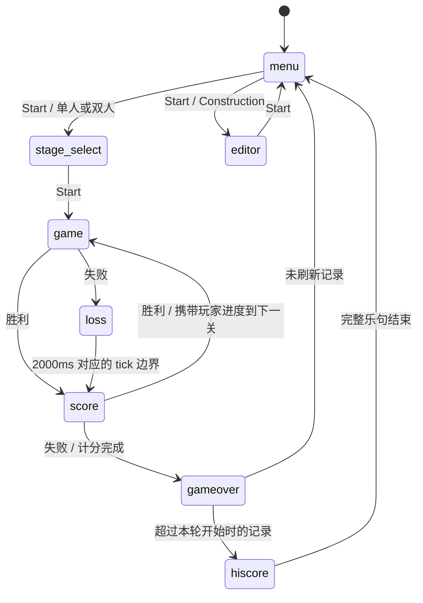

# 应用状态与时序

[`AppState`](../src/app/state.ts) 描述当前应用页面，引擎内部 `GamePhase` 描述战斗阶段。暂停保留当前页面和引擎进度。

## 流转职责

| 入口 | 必须一起完成的副作用 |
|---|---|
| `start` | 清空输入边沿和旧音频场景；按最终选择创建新引擎；安装世界、重置动画、同步音轨、呈现 intro |
| `menu` / `openEditor` | 解除失败 HUD；清空引擎引用、输入和旧场景音频；重置对应游标/计时与动画 |
| `finishBattle` | 固定最终分数；失败时复制演出世界，HUD 保持权威结果；停止战斗引擎音效 |
| `showScore` | 恢复权威世界、清输入、设置共享计分时序、初始化计数声音 |
| `advancePresentation` | 在边界 tick 进入下一状态；携带胜利后的玩家状态，或清空失败后的 Construction 地图并开始结尾音乐 |
| `inactive` | 丢弃累积时间与按住状态；暂停引擎或演出；立即使用焦点静音 |

选关只更新模式和关卡，不创建引擎或采样随机种子。Start 统一采样种子、创建 tick 0 的 intro 引擎；自定义地图及下一关携带状态使用同一启动路径。

Construction 草稿保留到本次运行结束，下一关恢复标准地图；Game Over 清空草稿。最高分在 Game Over 后更新本次页面内存，计分页仍显示进入本轮前的记录。第 70 关之后回到第 1 关。

## 固定步进约束

- 游戏 tick 为 `1000 / 60.0988` ms。一帧最多接纳 100ms 的 delta，最多执行 6 次固定步进；剩余不足一 tick 的时间保留。
- 一次战斗步进的顺序是规则更新 → 事件音效 → 动画观察 → 持续音轨状态同步。
- 所有实际步进完成后执行 `commitFrame()` 提交声音命令（不推进音频时间），再呈现页面。胜负与演出切换边界沿用相同提交顺序，边界 tick 属于刚进入的页面。
- 失败演出更新复制的世界，权威游戏结果保持不变；计分行数与音效共用 `scoreTimeline`。
- 失焦、隐藏和暂停不会积累补跑时间。回到页面后按 Start 继续；按住的旧按键必须释放或经过失焦状态清理。
- Construction 保留方向计数器，在第 20 tick 重复移动，此后每 5 tick 重复；切换方向不重置这个计数器。

`app/test-adapter.ts` 的单步接口仅用于测试搭建，不模拟真实音频时钟。键盘与 PCM 浏览器验收通过真实帧回调运行，不能用测试单步替代。
